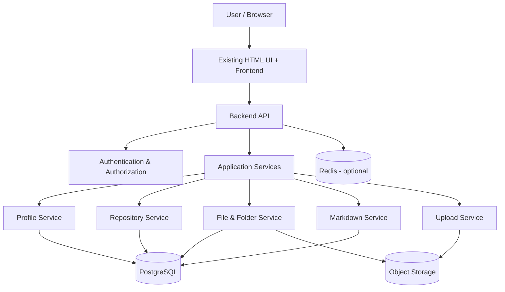
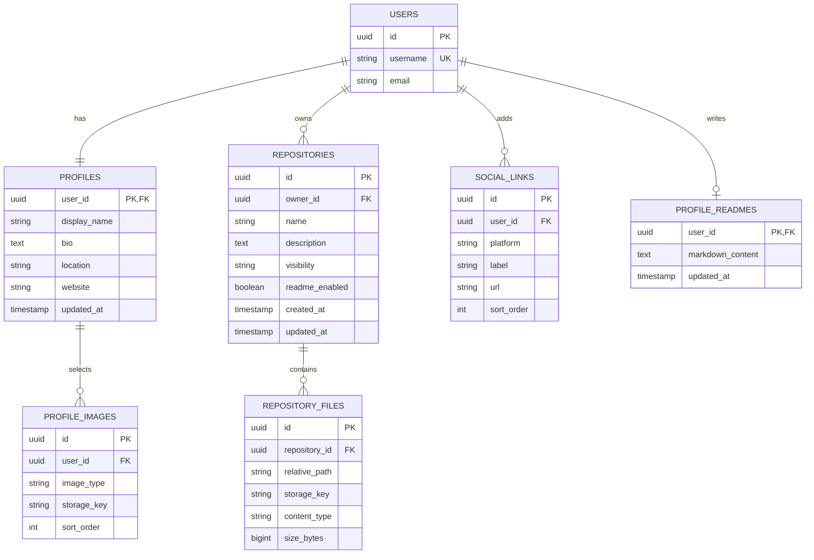
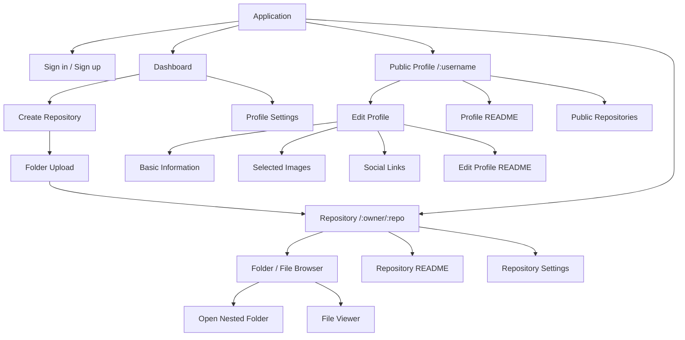

# KEX --- Project Blueprint for AI Agent

> **Purpose:** This document is the source of truth for understanding
> KEX, its architecture, product scope, and implementation rules. Read
> it before changing code.

## 1. Project identity

**KEX** is a developer-focused project hosting platform inspired by
GitHub, with its own identity. Users can create repositories, upload
existing project folders, browse files, and maintain customizable
developer profiles.

### First-release goals

1.  Create repositories and upload complete local project folders.
2.  Preserve nested directory structures and relative file paths.
3.  Browse folders and view/download files.
4.  Support public and private repositories with server-side access
    control.
5.  Provide developer profiles with selected images, descriptions, and
    social links.
6.  Allow users to edit a profile `README.md` directly from their
    profile.

Advanced Git features such as push/pull, branches, commits, pull
requests, issues, forks, discussions, and CI/CD are out of scope unless
already implemented.

## 2. CRITICAL: Preserve the existing HTML design

The user has already created HTML files containing the intended UI
design. **Those files are the visual source of truth.**

### Non-negotiable rules

-   Find and inspect all existing HTML files and their related CSS,
    JavaScript, assets, fonts, icons, and components before implementing
    UI changes.
-   Preserve the existing visual design: layout, spacing, sizing,
    typography, colors, borders, shadows, radii, icons, illustrations,
    animations, responsive behavior, and component arrangement.
-   **Do not redesign, restyle, modernize, simplify, replace, or
    reinterpret the UI.**
-   Do not replace the supplied HTML with a generic dashboard or a new
    template.
-   Do not change CSS/design tokens just to make implementation easier.
-   Change **content and functionality**, not the design.
-   Insert real data into the existing design and connect existing
    controls to real functionality.
-   If a required feature has no matching UI, report the gap and propose
    the smallest addition that matches the existing design. Do not
    invent a new visual system.
-   Avoid unrelated refactoring and preserve existing file/component
    structure where practical.

### Required UI inspection process

1.  Locate all supplied `.html` files.
2.  Identify which screen/component each file represents.
3.  Trace linked CSS, scripts, fonts, images, icons, and assets.
4.  Map each existing screen to the product requirements below.
5.  Report missing screens or interactions.
6.  Only then implement functionality by reusing the supplied design.

### UI acceptance criteria

Before/after screenshots should look visually the same in design.
Differences should be limited to real content, actual user/repository
data, functional interactions, and the smallest approved additions
required for missing functionality.

**This document is not permission to redesign the supplied HTML.**

## 3. Main user workflows

### 3.1 Create a repository

1.  User signs in.
2.  User selects **New Project / New Repository**.
3.  User enters repository name and optional description.
4.  User selects Public or Private.
5.  User enables or disables repository `README.md`.
6.  User selects a local project folder.
7.  Upload all files while preserving relative paths.
8.  Show progress, success, and actionable errors.
9.  Navigate to the new repository.

### 3.2 Browse a repository

-   Show repository name, owner, description, visibility, and relevant
    actions.
-   Show only the current directory's immediate child folders and files.
-   Show folders before files.
-   Never flatten the entire nested directory tree into one list.
-   Clicking a folder opens that folder's contents.
-   Show breadcrumbs and support parent-folder navigation.
-   Clicking a supported text file opens a safe file viewer.
-   Provide copy and download actions.
-   Binary/unsupported files should be downloadable rather than
    displayed as broken text.
-   If repository README is enabled and exists, render it below the root
    listing.
-   If README is disabled, do not render it as the repository
    introduction.

### 3.3 Public and private access

-   Public repositories can be viewed by visitors.
-   Private repositories are visible only to the owner and explicitly
    authorized users.
-   Enforce access on the backend/API and storage layer, not only in the
    frontend.
-   Never expose private metadata, file contents, or storage URLs
    through public endpoints.
-   Test both owner and unauthorized visitor access.

## 4. Developer profile

### Profile information

Users can edit: - Display name. - Username, subject to
uniqueness/account rules. - Bio/description. - Optional location. -
Website. - Optional public contact information. - Other profile fields
already represented in the supplied HTML.

Only show optional fields when provided and marked public.

### No profile pictures or avatars

-   Do not add profile pictures, default avatars, or initials avatars.
-   Users may select/upload visuals such as a banner, featured image, or
    gallery images.
-   If no image is selected, use the existing text-based profile layout.
-   Image controls must match the supplied design.

### Selected images

Support only image slots represented in the existing HTML, such as: -
Banner image. - Featured image. - Optional gallery images.

Allow upload, replacement, and removal. Validate file types and sizes.
Store image files safely and keep references/metadata in the database.

### Social links

Allow users to add, edit, and remove links such as GitHub, LinkedIn,
X/Twitter, YouTube, personal website, portfolio, email, and custom URLs.
Display only configured links. Validate URL schemes.

### Profile README.md --- core feature

Every user can maintain a profile `README.md` directly from their
profile: 1. Provide an **Edit README** action using the existing design.
2. Open a Markdown editor. 3. Provide Edit and Preview modes. 4. Support
headings, paragraphs, emphasis, lists, links, images, code blocks, and
tables. 5. Save content through the backend. 6. Render saved Markdown on
the public profile. 7. Let the owner edit it again at any time. 8.
Visitors can read it but cannot edit it. 9. Sanitize rendered Markdown
to prevent XSS and unsafe embedded content.

**Repository README and Profile README are separate resources.** A
repository README belongs to one repository; a profile README belongs to
one user.

## 5. Architecture overview

Reuse the existing architecture when equivalent services already exist.
Do not create duplicate services or replace working infrastructure
without a clear reason.



### Layer responsibilities

  -----------------------------------------------------------------------
  Layer                               Responsibility
  ----------------------------------- -----------------------------------
  Existing HTML/UI                    Preserve visual design; display
                                      real data and interactions

  Frontend                            Routing, forms, upload progress,
                                      file browsing, Markdown
                                      editor/preview

  Backend API                         Validate requests, authenticate
                                      users, enforce permissions

  Authentication                      Identify current user and validate
                                      sessions/tokens

  Profile service                     Profile fields, selected images,
                                      social links, profile README

  Repository service                  Repository creation, metadata,
                                      visibility, ownership

  File service                        Directory tree, file metadata,
                                      reads/downloads

  Upload service                      Validate and store files with
                                      relative paths preserved

  Markdown service                    Parse and safely render Markdown

  PostgreSQL                          Users, profiles, repositories, file
                                      metadata, links, README content

  Object storage                      Uploaded source files and
                                      profile/repository images

  Redis (optional)                    Cache, rate limits, temporary
                                      upload coordination if justified
  -----------------------------------------------------------------------

### Technology guidance

Follow the technologies already present. If the project is still being
established, the intended direction is: - Frontend: SvelteKit + Svelte
5 + TypeScript. - Backend: Fastify + TypeScript. - Database:
PostgreSQL. - Redis only where justified. - S3-compatible object
storage.

Do not migrate frameworks or databases just to match this
recommendation.

## 6. Data model (logical proposal)

Inspect existing migrations and tables first. Extend existing structures
instead of duplicating them.



These are conceptual entities, not mandatory table names. Add
appropriate foreign keys, indexes, uniqueness constraints, and
timestamps.

## 7. Folder upload and storage

Example uploaded folder:

``` text
my-project/
├── package.json
├── README.md
├── src/
│   ├── app.ts
│   └── components/
│       └── Button.svelte
└── public/
    └── logo.svg
```

Repository root should show:

``` text
my-project/
├── src/
├── public/
├── package.json
└── README.md
```

When `src/` is opened, show only its immediate children:

``` text
src/
├── components/
└── app.ts
```

Implementation rules: - Use browser directory selection where supported
and preserve each file's relative path (for example
`src/components/Button.svelte`). - Store file bytes in object storage. -
Store owner, repository, relative path, file size, content type, and
storage key metadata in PostgreSQL. - Scope storage keys to the correct
repository. - Never trust a client-supplied storage key. - Normalize and
validate paths. - Reject path traversal (`../`), absolute paths, invalid
paths, and conflicting duplicate paths. - Define upload size, file
count, and per-file limits. - Handle interrupted uploads and partial
failures safely. - Never make private object storage public.

## 8. Frontend route map

Adapt these logical routes to existing conventions.



Navigation requirements: - Public profile URLs are username-based. -
Repository URLs identify owner and repository. - Folder navigation
preserves repository context. - Breadcrumbs represent the actual
relative path. - Browser back/forward navigation works. - Unauthorized
visitors cannot open private repository pages or files.

## 9. Suggested API responsibilities

Adapt names to existing API conventions; do not duplicate existing
endpoints.

  ----------------------------------------------------------------------------------
  Method                  Suggested endpoint                 Responsibility
  ----------------------- ---------------------------------- -----------------------
  GET                     `/api/me`                          Current authenticated
                                                             user

  GET                     `/api/users/:username`             Public profile

  PATCH                   `/api/me/profile`                  Update own profile

  PUT                     `/api/me/profile/readme`           Create/update profile
                                                             README

  GET                     `/api/users/:username/readme`      Read public profile
                                                             README

  POST                    `/api/me/profile/images`           Upload profile image

  DELETE                  `/api/me/profile/images/:id`       Remove own image

  PUT                     `/api/me/profile/social-links`     Update own social links

  GET                     `/api/me/repositories`             List own repositories

  POST                    `/api/repositories`                Create repository

  GET                     `/api/repositories/:id/tree`       List immediate
                                                             directory children

  POST                    `/api/repositories/:id/upload`     Upload folder files

  GET                     `/api/repositories/:id/file`       Read authorized text
                                                             file

  GET                     `/api/repositories/:id/download`   Download authorized
                                                             file

  PATCH                   `/api/repositories/:id`            Update repository
                                                             metadata

  DELETE                  `/api/repositories/:id`            Delete repository
  ----------------------------------------------------------------------------------

Every endpoint must validate inputs, authenticate where required, check
ownership/permissions, return consistent errors, and avoid leaking
private resource information.

## 10. Security and reliability

-   Enforce private-resource authorization on the server.
-   Prevent path traversal and unsafe file paths.
-   Validate upload MIME/type, size, and file count.
-   Rate-limit authentication, uploads, and write operations.
-   Sanitize Markdown and validate external links.
-   Escape user-generated text and uploaded file names in the UI.
-   Never execute uploaded source files on the application origin.
-   Never expose public storage URLs for private files.
-   Handle empty repositories, missing README files, large folders, and
    unsupported file types.
-   Provide loading, empty, success, and error states using the existing
    design.
-   Do not log secrets or private file contents.

## 11. Implementation stages

### Stage 0 --- Inspect first (no code changes)

-   Read the project structure and package manifests.
-   Identify frontend, backend, database, auth, storage, and API
    modules.
-   Locate all supplied HTML files and trace their CSS/assets.
-   Map each HTML screen to a KEX feature.
-   Identify existing functionality to reuse.
-   Report completed features, gaps, risks, and dependencies.

### Stage 1 --- Backend and data foundation

-   Review schema and migrations.
-   Add only required profile/repository/file metadata.
-   Implement missing APIs.
-   Add validation and authorization tests.

### Stage 2 --- Repository creation and upload

-   Implement repository settings.
-   Implement folder upload preserving relative paths.
-   Add progress and error handling.
-   Verify nested paths.

### Stage 3 --- Repository browser

-   Implement immediate-child folder/file listing.
-   Implement nested navigation and breadcrumbs.
-   Implement safe file viewing, copy, and download.
-   Implement repository README rendering.

### Stage 4 --- Developer profile

-   Implement profile details and public profile route.
-   Implement selected images without avatars.
-   Implement social links.
-   Implement editable profile README with preview and safe rendering.
-   Display public repositories.

### Stage 5 --- Integration and verification

-   Test public/private permissions.
-   Test owner vs visitor behavior.
-   Test nested uploads and duplicate paths.
-   Test profile README editing and rendering.
-   Test responsive behavior.
-   Compare screenshots against original HTML design.
-   Fix functional bugs without redesigning the UI.

## 12. Acceptance checklist

### UI

-   [ ] All supplied HTML designs inspected.
-   [ ] Existing layout, typography, colors, spacing, assets, and
    animations preserved.
-   [ ] No generic replacement template introduced.
-   [ ] Only content and functionality changed, except approved minimal
    additions.

### Repository

-   [ ] User can create a repository.
-   [ ] Public/private visibility works.
-   [ ] Repository README can be enabled/disabled.
-   [ ] Folder upload preserves nested paths.
-   [ ] Root listing shows only immediate children.
-   [ ] Opening a folder shows only its immediate children.
-   [ ] Breadcrumb navigation works.
-   [ ] Text files can be viewed safely.
-   [ ] Files can be copied/downloaded.
-   [ ] Unauthorized users cannot access private files.

### Profile

-   [ ] Profile is accessible by username.
-   [ ] No avatar/profile picture/default avatar is shown.
-   [ ] User can edit name and description.
-   [ ] User can manage selected images.
-   [ ] User can manage social links.
-   [ ] User can create/edit/save profile README.md.
-   [ ] README preview works.
-   [ ] Visitors can read but cannot edit another user's README.
-   [ ] Public repositories are displayed.
-   [ ] Private repositories are hidden from visitors.

### Engineering

-   [ ] No mock data remains in completed flows.
-   [ ] API validation and authorization tests pass.
-   [ ] Migrations apply cleanly.
-   [ ] Upload failures are handled safely.
-   [ ] Existing working features are not broken.

## 13. Instructions to the AI agent

Before changing code: 1. Read this entire document. 2. Inspect the
actual repository and identify current implementation status. 3. Inspect
the user's existing HTML design files and linked assets. 4. Produce an
implementation report containing current architecture, existing screens
and their source files, APIs/database tables, completed and missing
features, risks, and a staged plan. 5. **Do not modify code or UI until
the inspection report is complete.**

During implementation: - Preserve the existing HTML design. - Change
content and connect functionality; do not redesign. - Reuse existing
code and conventions. - Do not use mock data to simulate completed
functionality. - Do not silently change the technology stack. - Keep
repository README and profile README separate. - Enforce private
repository permissions server-side. - Make small changes and run
relevant tests after each stage.

At completion, report files created/modified, migrations, APIs,
completed features, tests and results, known limitations, and next
steps.

**Final priority: correct functionality, secure data handling, and exact
preservation of the user's existing UI design.**
